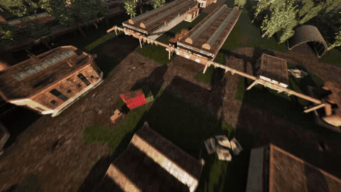
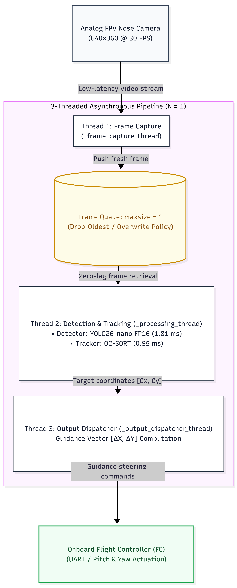
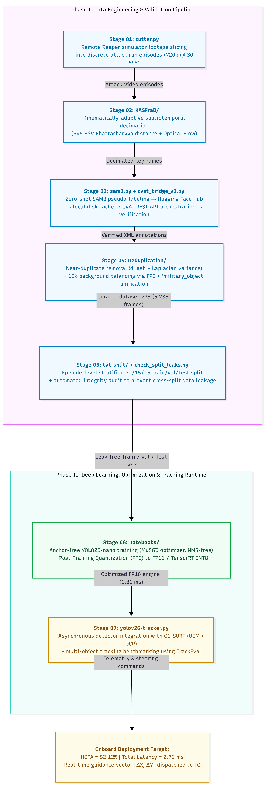
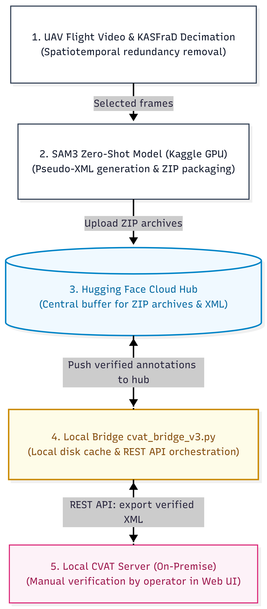
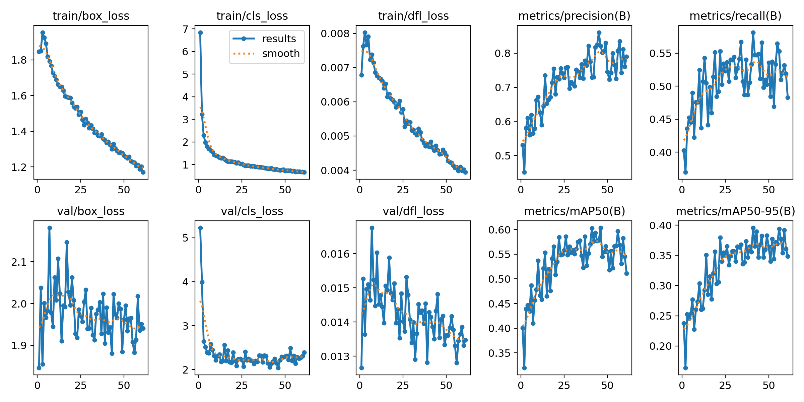
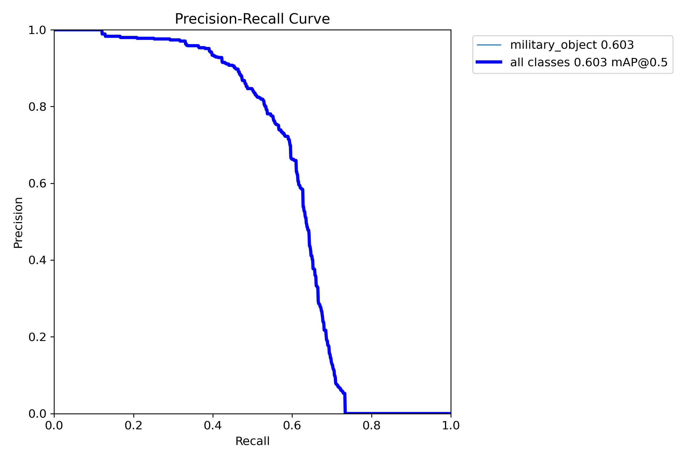
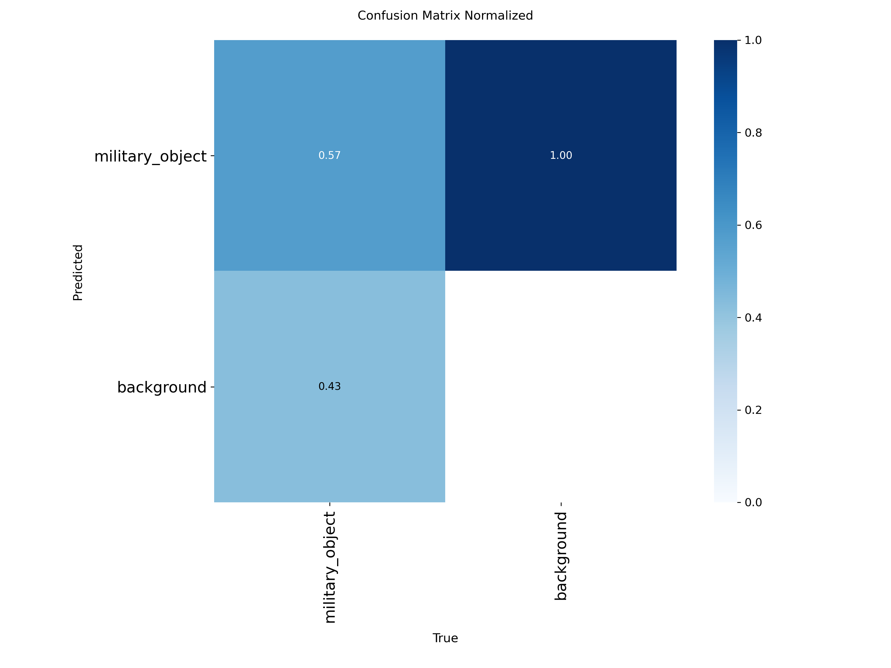
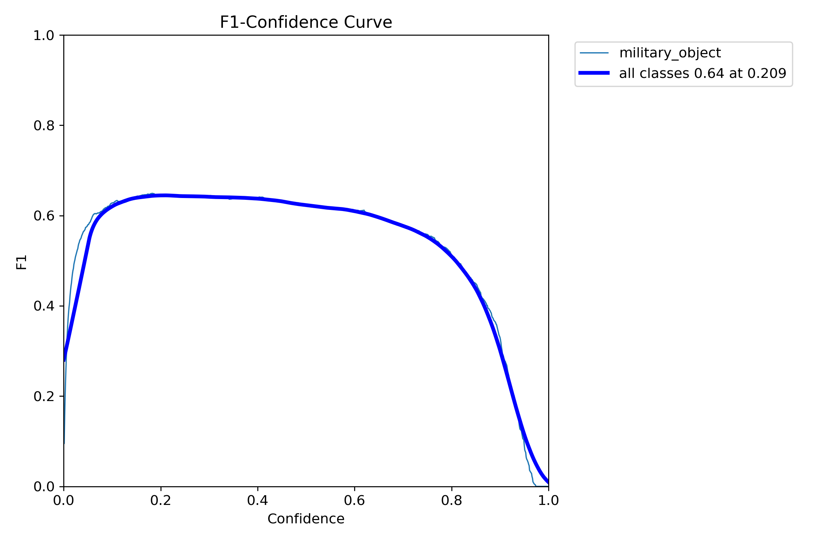

<p align="right">
  <b>English</b> | <a href="README_UA.md">Українська</a>
</p>

# Real-Time Autonomous Target Detection & Tracking for Low-SWaP FPV Drones

[-blue.svg)](#)
[](#)
[-success.svg)](#)
[-red.svg)](#)
[](LICENSE)

> **Autonomous Edge AI Target Detection & Tracking System**  
> *Research & Defense-Tech Showcase | Real-Time Embedded Computer Vision*

<p align="center">
  
</p>
<p align="center">
  <em>Live Autonomous Guidance Demo: YOLO26-nano (FP16) + OC-SORT maintaining persistent target lock during high-speed FPV maneuvers, dynamically computing deviation vector $[\Delta X, \Delta Y]$ relative to optical center $(320, 180)$ for flight controller servoing.</em>
</p>

---

## 🎯 Executive Summary & Problem Statement

Modern FPV combat drones rely on analog 5.8 GHz video links to achieve low transmission latencies (<20 ms). However, during the terminal dive phase (altitudes 10–20 m), tactical **Electronic Warfare (EW/jamming)** and radio-horizon loss frequently cause complete video feed degradation or severance. 

This project delivers an end-to-end, autonomous **Edge AI Target Lock** system capable of onboard real-time military vehicle detection, visual tracking under severe camera pitch/roll, and flight-controller guidance vector generation — functioning entirely without ground communication.

### 3-Threaded Asynchronous Real-Time Guidance Pipeline

<p align="center">
  
</p>
<p align="center">
  <em>Figure 1: Concurrency architecture isolating camera ingestion (30 FPS) from YOLO26-nano FP16 inference (552 FPS) via a zero-lag drop-oldest queue (N=1) and asynchronous flight controller telemetry dispatch.</em>
</p>

---

## 💼 Core Engineering Competencies & Skills Matrix

Designed for defense-tech computer vision leads and edge AI engineering teams, this project demonstrates end-to-end execution across the full autonomy stack:

| Domain | Core Skills & Methodologies | Production Implementation in Repository |
| :--- | :--- | :--- |
| **Edge AI & Low-SWaP Acceleration** | TensorRT FP16 / INT8 PTQ, ONNX Runtime, CUDA engine optimization, memory footprint pruning | Sub-3 ms YOLO26-nano deployment, zero-latency drop-oldest queue architecture, 552 FPS throughput |
| **Deep Learning & Detection** | End-to-end NMS-free architectures, Task-Aligned One-to-Many dual heads, MuSGD optimization, small-target feature retention | [`notebooks/`](notebooks/), [`yolov26_baseline_run7_results/`](yolov26_baseline_run7_results/), custom hyperparameter scheduling preventing target degradation |
| **Visual Servoing & Real-Time Tracking** | OC-SORT (OCM + OCR), linear state-space modeling, TrackEval benchmark integration, closed-loop flight telemetry | [`yolov26-tracker.py`](yolov26-tracker.py), high-angular-rate trajectory recovery (300°/s), spatial deviation vector generation $[\Delta X, \Delta Y]$ |
| **Algorithmic Data Engineering** | Kinematic video decimation, Lucas-Kanade optical flow, RANSAC affine modeling, perceptual hashing (dHash), Farthest Point Sampling | [`KASFraD/`](KASFraD/), [`Deduplication/`](Deduplication/), 50.5% redundant frame elimination without losing critical terminal dive states |
| **MLOps & Pipeline Tooling** | REST API automation, zero-shot pseudo-labeling (SAM3), leak-proof stratified dataset splitting, episode-level isolation | [`cvat_bridge_v3.py`](cvat_bridge_v3.py), [`sam3.py`](sam3.py), [`tvt-split/`](tvt-split/), [`check_split_leaks.py`](check_split_leaks.py), automated task orchestration |
| **Concurrent Systems Programming** | Multi-threaded asynchronous producer-consumer engines, bounded lock-free queues, OS thread affinity | 3-threaded Python/C++ pipeline architecture decoupling 30 FPS camera ingestion from 552 FPS inference |

---

## 🗺️ 7-Stage End-to-End Pipeline Execution Map

The engineering workflow spans 7 production stages categorized into two distinct operational phases: **Phase I: Data Engine & Pre-Annotation Lifecycle** (offline/cloud) and **Phase II: Model Optimization & Real-Time Onboard Guidance** (runtime/edge).

<p align="center">
  
</p>
<p align="center">
  <em>Figure 2: Complete 7-stage architectural roadmap from raw tactical video ingestion to real-time flight controller guidance vector dispatch.</em>
</p>

### Phase I: Data Engine & Pre-Annotation Lifecycle (Offline / Cloud)
- **Stage 01: Raw Video Ingestion & Episode Slicing ([`cutter.py`](cutter.py))**  
  Ingests multi-camera combat/simulation telemetry videos, programmatically splitting them into discrete, serialized flight episodes based on flight mission metadata and altitude profiles.
- **Stage 02: Kinematic Spatiotemporal Decimation ([`KASFraD/`](KASFraD/))**  
  Applies a two-tier filter: Level 1 computes 2D HSV Bhattacharyya distance across a $5 \times 5$ spatial grid; Level 2 tracks Shi-Tomasi corners via Lucas-Kanade optical flow and fits an affine RANSAC model. Automatically bypasses decimation when optical expansion indicates terminal dive ($s \ge 1.03$), eliminating 50.5% redundant flight frames.
- **Stage 03: Cloud Zero-Shot Pseudo-Annotation ([`sam3.py`](sam3.py), [`cvat_bridge_v3.py`](cvat_bridge_v3.py))**  
  Scales out zero-shot mask/bounding-box generation across cloud GPUs using Segment Anything 3 (SAM3), reformats predictions to YOLO annotation coordinates, pushes intermediate buffers to a private Hugging Face registry, and synchronizes tasks to CVAT via REST API for human verification.
- **Stage 04: Perceptual Deduplication & Focus Filtering ([`Deduplication/`](Deduplication/))**  
  Eliminates residual duplicates via 64-bit difference hashing (dHash) and Laplacian variance focus evaluation. Injects a strictly balanced 10% negative background frame pool sampled via Farthest Point Sampling (FPS) in Hamming space (85% sharp / 15% motion-blurred).
- **Stage 05: Multi-Map Stratified Splitting & Leak Verification ([`tvt-split/`](tvt-split/), [`check_split_leaks.py`](check_split_leaks.py))**  
  Partitions datasets at the episode level across diverse terrain maps to eliminate temporal data leakage between Train, Validation, and Test splits. Verifies zero perceptual hash collisions across splits prior to training.

### Phase II: Model Optimization & Real-Time Onboard Guidance (Runtime / Edge)
- **Stage 06: YOLO26 Model Training & PTQ Quantization ([`notebooks/`](notebooks/), [`yolov26_baseline_run7_results/`](yolov26_baseline_run7_results/))**  
  Trains YOLO26-nano utilizing the MuSGD optimizer and dual-head NMS-free architecture. Disables destructive augmentations (`scale=0.0`, `shear=0.0`) to preserve distant 10–50 px military targets. Quantizes weights via Post-Training Quantization (PTQ) to FP16 / INT8 TensorRT engines.
- **Stage 07: Real-Time Multi-Threaded Guidance & Tracking Loop ([`yolov26-tracker.py`](yolov26-tracker.py))**  
  Executes an asynchronous 3-threaded pipeline: Thread 1 grabs camera frames at 30 FPS; Thread 2 runs YOLO26-nano FP16 inference (1.81 ms) and OC-SORT tracking with Observation-Centric Momentum (0.95 ms); Thread 3 converts optical center deviations $[\Delta X, \Delta Y]$ into flight controller guidance commands at sub-3 ms latency.

---

## 🏗️ System Architecture & Data Engineering Pipeline

The system integrates an automated cloud-to-edge data preparation and pseudo-labeling pipeline coupled with local on-premise verification:

<p align="center">
  
</p>
<p align="center">
  <em>Figure 3: Data preparation lifecycle — KASFraD spatiotemporal decimation, SAM3 zero-shot pseudo-annotation on cloud GPU, central Hugging Face registry buffer, and on-premise CVAT REST API verification.</em>
</p>

> 🔍 **Comprehensive Dual-Tier Architecture:**  
> For the complete multi-process infrastructure diagram (including local disk caching, episode batch slicing, and bidirectional CVAT synchronization), inspect the [Detailed On-Premise & Cloud System Architecture (long_en.png)](assets/long_en.png).

---

## ⚡ Key Engineering & Algorithmic Highlights

### 1. Data Engineering: KASFraD & Balanced Deduplication
- **KASFraD (Kinematically-Adaptive Spatiotemporal Frame Decimation):**
  - **Level 1 (Color-structural):** 2D HSV Bhattacharyya distance across a $5 \times 5$ spatial grid weighted by Canny edge density and camera elevation masks.
  - **Level 2 (Kinematic divergence):** Shi-Tomasi feature tracking via Lucas-Kanade optical flow + RANSAC affine motion modeling. Automatically bypasses decimation during terminal attack diving ($s \ge 1.03$).
- **dHash & Laplacian Sharpness Filter:** Computes 64-bit difference hashes and Laplacian variance; resolves near-duplicate conflicts by automatically retaining the sharpest image.
- **Farthest Point Sampling (FPS) Negative Pool:** Balances background frames to exactly 10% in 64-bit Hamming space (85% crisp / 15% motion-blurred).
- **Result:** **50.5% dataset reduction** (11,585 $\rightarrow$ 5,735 frames) with zero semantic information loss and elimination of background overfitting.

### 2. Edge Detector: YOLO26-nano (NMS-Free & MuSGD)
- **Zero-NMS Overhead:** Replaces post-processing NMS with dual-head label assignment during training (Task-Aligned One-to-Many head) and direct regression during onboard inference (One-to-One head).
- **MuSGD Optimizer:** Momentum-updated SGD dynamically adapts learning steps across dual heads to prevent early-epoch gradient conflicts.
- **Spatial Resolution Protection:** Eliminates scale distortions (`scale=0.0`, `shear=0.0`) to preserve small vehicle features (10–50 px) at long standoff ranges.

### 3. Visual Tracking: Observation-Centric SORT (OC-SORT)
- Replaces classical linear Kalman extrapolation with **Observation-Centric Momentum (OCM)** and **Observation-Centric Recovery (OCR)**.
- Overcomes high angular camera rates (up to 300°/s) and temporary occlusions under foliage/smoke.
- Trajectory fragmentation cut in half compared to ByteTrack ($4 \rightarrow 2$), improving **HOTA to 52.12%**.

### 4. 3-Threaded Zero-Lag Asynchronous Engine
- Enforces a **drop-oldest queue policy ($N=1$)** between camera intake and inference.
- Prevents queue backlog build-up, guaranteeing that the flight controller receives fresh spatial deviation coordinates $[\Delta X, \Delta Y]$ relative to optical center $(320, 180)$ with **2.761 ms total latency** (against a 40–50 ms sensorimotor budget).

---

## ⚖️ Key Engineering Trade-offs & Architectural Decisions

Every architectural choice was driven by the strict physical constraints of combat FPV flight: low compute budget (Jetson Orin Nano / RK3588, <15W), extreme angular dynamics (up to 300°/s), and real-time guidance loop deadlines:

### 1. Why KASFraD instead of Uniform Frame Decimation?
- **Trade-off:** Standard uniform decimation (e.g. saving every $k$-th frame) either oversamples redundant high-altitude cruise frames or undersamples the terminal attack dive.
- **Engineering Decision:** KASFraD couples 2D HSV Bhattacharyya distance with Lucas-Kanade optical flow affine divergence. When the drone initiates terminal diving, optical expansion causes scale factor $s \ge 1.03$, which dynamically halts decimation and preserves 100% of attack frames. At cruise altitude, it discards 50.5% of redundant frames, cutting annotation cost in half without sacrificing terminal accuracy.

### 2. Why NMS-Free YOLO26 over Standard YOLOv8 with Post-Processing NMS?
- **Trade-off:** Traditional Non-Maximum Suppression (NMS) has $\mathcal{O}(N^2)$ worst-case time complexity, executes sequentially on CPU or incurs GPU sync stalls, creating non-deterministic latency jitter (adding 10–25 ms when processing cluttered scenes).
- **Engineering Decision:** YOLO26 employs dual label assignment during training (Task-Aligned One-to-Many head) and direct regression during inference (One-to-One head). The detector outputs final bounding boxes directly without NMS overhead, providing a deterministic 1.81 ms GPU execution time and eliminating CPU-GPU memory transfer bottlenecks.

### 3. Why OC-SORT instead of ByteTrack for FPV Dynamics?
- **Trade-off:** ByteTrack relies on classical linear Kalman filtering assuming constant velocity. FPV drones perform aggressive yaw/pitch rotations ($\omega \ge 300^\circ/\text{s}$) and banking maneuvers where linear motion assumptions fail, causing track loss and ID switches.
- **Engineering Decision:** OC-SORT introduces Observation-Centric Momentum (OCM), which calculates directional velocity vectors directly over observation pairs, and Observation-Centric Recovery (OCR), which recovers lost tracks through re-association upon target re-emergence. On test sequences, OC-SORT improved HOTA from 45.69% to 52.12% (+6.43%) and halved trajectory fragmentations from 4 to 2.

### 4. Why Drop-Oldest Queue ($N=1$) instead of Standard FIFO Queue?
- **Trade-off:** A standard First-In-First-Out (FIFO) queue guarantees that every frame is processed, but under burst load or sensor frame pacing irregularities, frames accumulate in the queue.
- **Engineering Decision:** In terminal guidance, stale information is fatal. At a dive speed of 100 km/h (27.8 m/s), a 100 ms queue backlog translates to 2.78 meters of physical flight drift, causing terminal overshoot. A bounded drop-oldest queue ($N=1$) guarantees that the detector always receives the latest acquired camera frame, holding end-to-end guidance latency to 2.761 ms.

---

## 📊 Comprehensive Experimental Benchmarks

### 1. Model Quantization: FP32 vs FP16 (Test Split: 759 frames, 640x360)
Conducted on an NVIDIA T4 GPU testbed:

| Configuration | mAP50 | mAP50-95 | Precision | Recall | Latency | Throughput |
| :--- | :---: | :---: | :---: | :---: | :---: | :---: |
| **YOLO26-nano (FP32)** | 0.7587 | 0.4377 | 0.8395 | 0.6845 | 2.31 ms | 433.7 FPS |
| **YOLO26-nano (FP16)** | **0.7563** | **0.4367** | **0.8378** | **0.6845** | **1.81 ms** | **552.7 FPS** |
| **Delta** | *-0.24%* | *-0.10%* | *-0.17%* | **0.00%** | **-21.6% faster** | **+27.4% FPS** |

*Key finding:* Transitioning to FP16 reduces inference latency by 21.6% while preserving 100% of detection recall (zero dropped targets).

### 2. Multi-Object Tracking Evaluation (TrackEval, 860 Test Frames)

| Tracker Configuration | HOTA (%) | DetA (%) | AssA (%) | IDF1 (%) | MOTA (%) | MOTP (%) | IDSW | Frag |
| :--- | :---: | :---: | :---: | :---: | :---: | :---: | :---: | :---: |
| **ByteTrack (Optimal)** | 45.69 | 50.28 | 41.60 | 60.98 | 65.22 | 72.42 | 4 | 4 |
| **OC-SORT (Optimal)** | **52.12** | **56.48** | **48.15** | **65.56** | **65.94** | **81.49** | **4** | **2** |
| **OC-SORT (High-Buffer)** | 50.12 | 60.34 | 41.69 | 62.10 | 69.56 | 81.55 | 6 | 2 |

*Advantage:* OC-SORT outperforms ByteTrack by **+6.43% HOTA** and cuts trajectory fragmentations from 4 down to 2.

### 3. End-to-End Latency vs SWaP-C Real-Time Envelope

```
Real-Time FPV Budget: [========================================] 40.0 ms
Achieved Total Pipeline: [==] 2.761 ms (1.81 ms YOLO26 + 0.95 ms OC-SORT)
Safety Margin: 93.1% headroom
```

---

## 📈 Training & Validation Curves

Metric curves generated during training runs:

| Loss & mAP Evolution | Precision-Recall (PR) Curve |
| :---: | :---: |
|  |  |

| Normalized Confusion Matrix | F1-Confidence Curve |
| :---: | :---: |
|  |  |

---

## 🗂️ Project Modules & Architecture Overview

The codebase is organized into modular pipelines reflecting the actual research and deployment workflow:

- **[`KASFraD/`](KASFraD/)** — *Kinematically-Adaptive Spatiotemporal Frame Decimation:* Two-level video decimation combining 2D HSV Bhattacharyya distance with Lucas-Kanade/RANSAC optical flow scale divergence.
- **[`Deduplication/`](Deduplication/)** — *Near-Duplicate & Blur Filtering:* 64-bit difference hashing (dHash) and Laplacian variance focus estimation to retain sharpest frames and eliminate redundant flight states.
- **[`tvt-split/`](tvt-split/)** — *Multi-Map Stratified Splitting:* Episode-level stratified dataset partitioning preventing data leakage across flight trajectories, with automated balance reports ([`dataset_analysis_report_v25.md`](tvt-split/dataset_analysis_report_v25.md)).
- **[`sam3.py`](sam3.py) & [`cvat_bridge_v3.py`](cvat_bridge_v3.py)** — *Automated Cloud Annotation & Verification:* Zero-shot SAM3 pseudo-label generation on cloud GPU with automated CVAT REST API task orchestration.
- **[`yolov26-tracker.py`](yolov26-tracker.py)** — *Multi-Object Tracking & Evaluation:* Real-time tracking pipeline and TrackEval grid search comparing OC-SORT against ByteTrack.
- **[`yolov26_baseline_run7_results/`](yolov26_baseline_run7_results/)** — *Empirical Validation Artifacts:* Raw training metrics (`results.csv`), hyperparameter configs (`args.yaml`), and performance curves.
- **[`notebooks/`](notebooks/)** — *Cloud Training & PTQ Pipeline:* Structured Jupyter notebook for end-to-end YOLO26-nano training, MuSGD optimization, and TensorRT INT8 / ONNX FP16 compilation.
- **[`docs/`](docs/)** — *Technical Documentation:* Mathematical derivations, SWaP-C constraints analysis, and tracking state space equations.

---

## ⚖️ License & Terms of Use

This repository is distributed under the **Non-Commercial Academic Research and Educational License**.
- **Permitted:** Academic research, personal educational study, scientific publication review, algorithmic evaluation.
- **Prohibited:** Any commercial exploitation, closed commercial integration, military contractor mass production, or resale without prior written agreement.
- For full legal terms, consult [`LICENSE`](LICENSE). For commercial inquiries or technology licensing, contact the author via the GitHub profile.

---

*Note on Data Privacy & Security:* In compliance with sensitive data regulations, raw simulation combat videos, proprietary dataset image frames, and private model weights have been omitted from this public repository. All architecture designs, algorithmic implementations, metric evaluations, and benchmarking pipelines are fully disclosed.
