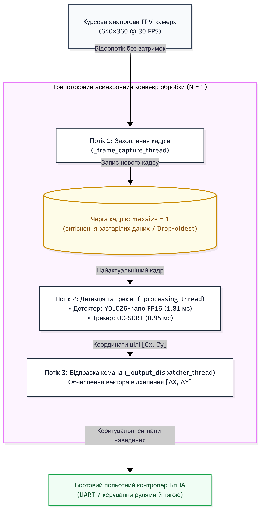
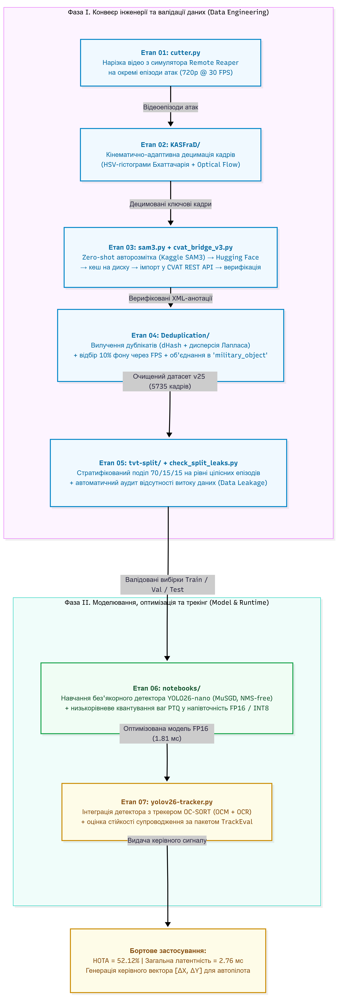

<p align="right">
  <a href="README.md">English</a> | <b>Українська</b>
</p>

# Автономний програмний комплекс виявлення та трекінгу цілей для FPV-дронів (Edge AI)

[-blue.svg)](#)
[](#)
[-success.svg)](#)
[-red.svg)](#)
[](LICENSE)

> **Автономна бортова система комп'ютерного зору для термінального донаведення БпЛА**  
> *Науково-технічний проєкт | Комп'ютерний зір реального часу на вбудованих платформах*

<p align="center">
  
</p>
<p align="center">
  <em>Демонстрація реального часу: автономне супроводження цілі (YOLO26-nano FP16 + OC-SORT) із безперервним формуванням вектора розбалансу $[\Delta X, \Delta Y]$ від оптичного центру $(320, 180)$ для польотного контролера під час маневрів пікірування на ціль.</em>
</p>

---

## 🎯 Анотація та постановка проблеми

Сучасні ударні FPV-дрони використовують аналоговий відеозв'язок (5.8 ГГц) для мінімізації затримки передачі сигналу (<20 мс). Проте на термінальній ділянці пікірування (висоти 10–20 м) дія тактичних засобів **радіоелектронної боротьби (РЕБ)** та втрата радіогоризонту рельєфом спричиняють деградацію або повне зникнення відеосигналу. Це унеможливлює ручне коригування траєкторії оператором.

У цьому проєкті реалізовано автономний бортовий комплекс **Edge AI Target Lock**, який виконує детекцію військової техніки в реальному часі, стійке візуальне супроводження об'єкта під час різких кутових маневрів та генерацію керуючого вектора розбалансу $[\Delta X, \Delta Y]$ для польотного контролера без використання зовнішнього зв'язку.

### 3-Потокова асинхронна архітектура інференсу та трекінгу

<p align="center">
  
</p>
<p align="center">
  <em>Рисунок 1: Багатопотоковий конвеєр із чергою витіснення застарілих кадрів (N=1), що гарантує наскрізну латентність 2.76 мс і нульове відставання в контурі керування БпЛА.</em>
</p>

---

## 💼 Матриця інженерних компетенцій та стек технологій

Проєкт демонструє практичну інженерну експертизу повного циклу розробки автономних систем комп'ютерного зору (Full-Stack Edge CV/ML):

| Напрям | Ключові інженерні навички та методи | Реалізація в репозиторії |
| :--- | :--- | :--- |
| **Edge AI та оптимізація під Low-SWaP** | Квантування TensorRT FP16 / INT8 PTQ, ONNX Runtime, мінімізація споживання RAM/VRAM, апаратне прискорення | Суб-3 мс інференс YOLO26-nano (552 FPS), асинхронна черга витіснення застарілих кадрів |
| **Глибоке навчання та детекція** | Архітектури без NMS (NMS-free), дуальне призначення міток (One-to-Many / One-to-One), оптимізатор MuSGD | [`notebooks/`](notebooks/), [`yolov26_baseline_run7_results/`](yolov26_baseline_run7_results/), збереження мікроознак техніки (10–50 px) без спотворень |
| **Візуальне супроводження та сервопривід** | Алгоритми OC-SORT (OCM + OCR), розширений фільтр Калмана, бенчмаркінг через TrackEval, розрахунок вектору наведення | [`yolov26-tracker.py`](yolov26-tracker.py), компенсація різких поворотів планера (300°/с), формування сигналів неузгодженості $[\Delta X, \Delta Y]$ |
| **Алгоритмічний Data Engineering** | Адаптивне кінематичне проріджування відео, оптичний потік Лукаса-Канаде, афінні моделі RANSAC, перцептивний dHash, FPS | [`KASFraD/`](KASFraD/), [`Deduplication/`](Deduplication/), скорочення датасету на 50.5% зі збереженням критичних кадрів пікірування |
| **MLOps та автоматизація пайплайнів** | Автоматизація через REST API, zero-shot псевдорозмітка (SAM3), епізодична стратифікація вибірок, валідація витоків | [`cvat_bridge_v3.py`](cvat_bridge_v3.py), [`sam3.py`](sam3.py), [`tvt-split/`](tvt-split/), [`check_split_leaks.py`](check_split_leaks.py), автоматична синхронізація з CVAT |
| **Багатопотокові асинхронні системи** | Патерн Producer-Consumer, обмежені черги з політикою drop-oldest, ізоляція системних затримок | 3-потокова архітектура розв'язки захоплення сенсора (30 FPS), інференсу (552 FPS) та телеметрії польотного контролера |

---

## 🗺️ Наскрізна карта конвеєра: 7 етапів життєвого циклу

Розробка охоплює 7 інженерних етапів, розділених на дві ключові фази: **Фаза I: Підготовка даних та авторозмітка** (хмарно-локальний конвеєр) та **Фаза II: Оптимізація моделі та бортове супроводження** (виконання в реальному часі на Edge AI).

<p align="center">
  
</p>
<p align="center">
  <em>Рисунок 2: Повна наскрізна архітектурна схема системи: від обробки сирого тактичного відео до формування векторів наведення на польотний контролер.</em>
</p>

### Фаза I: Конвеєр даних та авторозмітка (Хмара / On-Premise)
- **Етап 01: Нарізка епізодів та первинна обробка ([`cutter.py`](cutter.py))**  
  Сегментація сирих полігонних та симуляційних відеозаписів на дискретні польотні місії (епізоди) із прив'язкою до часових міток та профілів висоти.
- **Етап 02: Кінематичне проріджування KASFraD ([`KASFraD/`](KASFraD/))**  
  Дворівнева фільтрація: Рівень 1 оцінює колірно-структурні зміни (відстань Бхаттачарія за 2D HSV-гістограмами); Рівень 2 відстежує рух точок Ши-Томазі через оптичний потік Лукаса-Канаде та афінну матрицю RANSAC. При коефіцієнті масштабування $s \ge 1.03$ (пікірування) децимація автоматично блокується. Відсікає 50.5% статичних кадрів.
- **Етап 03: Хмарна zero-shot авторозмітка ([`sam3.py`](sam3.py), [`cvat_bridge_v3.py`](cvat_bridge_v3.py))**  
  Генерація псевдорозмітки об'єктів за допомогою SAM3 на потужних хмарних GPU, конвертація у формат YOLO, завантаження у проміжний реєстр Hugging Face та автоматизована передача завдань на ручну верифікацію через CVAT REST API.
- **Етап 04: Перцептивна дедуплікація та відбір фону ([`Deduplication/`](Deduplication/))**  
  Усунення майже ідентичних кадрів через 64-бітний dHash та оцінку різкості за дисперсією Лапласіана. Формування збалансованого пулу фонових кадрів (10%) методом Farthest Point Sampling у просторі Хеммінга (85% чітких / 15% із динамічним розмиттям).
- **Етап 05: Епізодична стратифікація та перевірка витоків ([`tvt-split/`](tvt-split/), [`check_split_leaks.py`](check_split_leaks.py))**  
  Розбиття датасету на вибірки Train, Val та Test виключно на рівні цілісних епізодів з урахуванням різних локацій. Перевірка відсутності колізій перцептивних хешів між сплітами ([`check_split_leaks.py`](check_split_leaks.py)).

### Фаза II: Оптимізація моделі та бортове супроводження (Edge Runtime)
- **Етап 06: Тренування YOLO26 та квантування PTQ ([`notebooks/`](notebooks/), [`yolov26_baseline_run7_results/`](yolov26_baseline_run7_results/))**  
  Навчання детектора YOLO26-nano з оптимізатором MuSGD та дуальною архітектурою без NMS. Збереження геометрії мікроцілей (10–50 px) шляхом вимкнення спотворюючих аугментацій (`scale=0.0`, `shear=0.0`). Посттренувальне квантування (PTQ) ваг у формати TensorRT FP16 та INT8.
- **Етап 07: 3-Потоковий асинхронний контур супроводження ([`yolov26-tracker.py`](yolov26-tracker.py))**  
  Асинхронний конвеєр: Потік 1 (захоплення відео 30 FPS) $\rightarrow$ Черга $N=1$ із витісненням застарілих кадрів $\rightarrow$ Потік 2 (інференс YOLO26 FP16 1.81 мс + OC-SORT OCM/OCR 0.95 мс) $\rightarrow$ Потік 3 (генерація векторів розбалансу $[\Delta X, \Delta Y]$ та передача в польотний контролер).

---

## 🏗️ Архітектура конвеєра даних та авторозмітки

Для підготовки якісного тактичного датасету реалізовано автоматизований конвеєр генерації псевдорозмітки з використанням хмарних ресурсів та локальної верифікації в CVAT:

<p align="center">
  
</p>
<p align="center">
  <em>Рисунок 3: Життєвий цикл підготовки даних — кінематична децимація KASFraD, хмарна авторозмітка SAM3, буферний реєстр Hugging Face та локальна верифікація через CVAT REST API.</em>
</p>

> 🔍 **Розгорнута дворівнева архітектура:**  
> Повну багаторівневу інженерну схему (включаючи локальне дискове кешування, нарізку епізодів, керування чергами та статус-локінг завдань) наведено у файлі [Детальна системна архітектура (long_ua.png)](assets/long_ua.png).

---

## ⚡ Ключові інженерні та алгоритмічні рішення

### 1. Data Engineering: KASFraD та збалансована дедуплікація
- **KASFraD (Кінематично-адаптивне просторово-часове проріджування):**
  - **Рівень 1 (Колірно-структурний):** Відстань Бхаттачарія між 2D HSV-гістограмами по сітці $5 \times 5$, зважена за щільністю контурів Кенні та просторовою картою кадру (зниження чутливості до неба/горизонту, підвищення у фокальній зоні).
  - **Рівень 2 (Кінематичний):** Оптичний потік Лукаса-Канаде по точках Ши-Томазі з афінною моделлю RANSAC. При коефіцієнті наближення $s \ge 1.03$ децимація автоматично вимикається для збереження всіх кадрів атаки.
- **dHash та фільтр розмиття Лапласіана:** 64-бітне різницеве хешування відсікає дублікати ($\text{Hamming} \le 3$), а дисперсія Лапласіана автоматично залишає найбільш чіткий кадр.
- **Балансування фону за алгоритмом FPS:** Farthest Point Sampling у просторі Хеммінга забезпечує рівно 10% різноманітного фону (85% чітких сцен + 15% з динамічним розмиттям руху).
- **Результат:** скорочення вибірки на **50.5%** (з 11 585 до 5 735 кадрів) без втрати інформативності та усунення перенавчання на статичний фон.

### 2. Бортовий детектор: YOLO26-nano (NMS-Free та MuSGD)
- **Відмова від NMS:** Навчання з дуальним призначенням міток (Task-Aligned One-to-Many гілка) та пряма регресія на інференсі (One-to-One гілка). Нульові часові витрати на постобробку.
- **Оптимізатор MuSGD:** Momentum-updated SGD стабілізує сходження градієнтів між паралельними гілками детектора.
- **Збереження роздільної здатності для малих цілей:** Вимкнення деструктивного масштабування (`scale=0.0`, `shear=0.0`) зберігає піксельну структуру техніки (10–50 px) на великих відстанях.

### 3. Алгоритм супроводження: OC-SORT
- Компенсація помилок екстраполяції лінійного фільтра Калмана за допомогою моделей **Observation-Centric Momentum (OCM)** та **Observation-Centric Recovery (OCR)**.
- Стійкість до різких кутових поворотів планера (до 300°/с) та тимчасових перекриттів рослинністю/димом.
- Зниження кількості розривів траєкторій удвічі ($4 \rightarrow 2$) та приріст інтегральної оцінки **HOTA до 52.12%**.

### 4. 3-Потоковий асинхронний конвеєр без накопичення затримок
- Використання черги місткістю **$N=1$ із політикою витіснення застарілих кадрів** ($Q_t = \{F_k\} \setminus \{F_{k-1}\}$).
- Повне усунення черг застарілих кадрів: польотний контролер гарантовано отримує свіжі координати $[\Delta X, \Delta Y]$ від оптичного центру $(320, 180)$ із загальною затримкою **2.761 мс** (при ліміті 40–50 мс).

---

## ⚖️ Ключові інженерні компроміси та архітектурні рішення

Кожне архітектурне рішення базувалося на фізичних обмеженнях польоту FPV-дрона: жорсткий тепловий та енергетичний бюджет бортових обчислювачів (Jetson Orin Nano / RK3588, <15 Вт), екстремальні кутові швидкості (до 300°/с) та вимоги до детермінованого часу реакції:

### 1. Чому KASFraD замість рівномірного проріджування кадрів?
- **Проблема:** Стандартний пропуск фіксованої кількості кадрів (наприклад, збереження кожного $k$-го кадру) або генерує тисячі надлишкових кадрів під час горизонтального польоту, або втрачає критичні кадри під час швидкісного пікірування на ціль.
- **Інженерне рішення:** KASFraD поєднує 2D HSV гістограмний аналіз із кінематичною оцінкою оптичного потоку за методом Лукаса-Канаде та RANSAC. Під час пікірування оптичне розширення сцени ($s \ge 1.03$) миттєво вимикає проріджування, гарантуючи збереження 100% кадрів атаки. На крейсерському польоті алгоритм відкидає 50.5% надлишкового матеріалу, вдвічі знижуючи витрати на розмітку та усуваючи перенавчання.

### 2. Чому YOLO26 без NMS замість класичного YOLOv8 з NMS?
- **Проблема:** Традиційний алгоритм Non-Maximum Suppression (NMS) має квадратичну складність $\mathcal{O}(N^2)$, виконується на CPU або вимагає синхронізації GPU-пам'яті, створюючи стохастичні затримки (10–25 мс) при великій кількості хибних спрацювань на складних фонах.
- **Інженерне рішення:** YOLO26 використовує дуальне призначення міток під час навчання (One-to-Many гілка) та пряму регресію без NMS на інференсі (One-to-One гілка). Детектор видає фінальні координати цілей безпосередньо з вихідного тензора, забезпечуючи детерміновану затримку інференсу 1.81 мс без просідань FPS.

### 3. Чому OC-SORT замість ByteTrack для динаміки FPV?
- **Проблема:** ByteTrack базується на лінійному фільтрі Калмана з припущенням про рівномірний прямолінійний рух. Під час різких віражів та тангажу FPV-дрона (кутова швидкість $\omega \ge 300^\circ/\text{с}$) лінійна екстраполяція дає збій, спричиняючи втрату треку та численні ID Switches.
- **Інженерне рішення:** OC-SORT реалізує механізм Observation-Centric Momentum (OCM), що розраховує імпульс руху безпосередньо за спостережуваними координатами, та Observation-Centric Recovery (OCR) для ретроспективного відновлення втрачених цілей. Це підвищило точність HOTA з 45.69% до 52.12% (+6.43%) і скоротило кількість розривів траєкторій удвічі ($4 \rightarrow 2$).

### 4. Чому черга $N=1$ із витісненням застарілих кадрів (Drop-Oldest) замість FIFO?
- **Проблема:** Стандартна черга FIFO зберігає всі кадри, але при тимчасовому сплеску навантаження формує затримку буферизації. На швидкості пікірування 100 км/год (27.8 м/с) відставання черги всього на 100 мс означає 2.78 метра просторового зсуву, що веде до промаху дрона повз ціль.
- **Інженерне рішення:** У контурі термінального наведення застарілий кадр є шкідливим. Обмежена черга розміром $N=1$ з політикою заміщення гарантує, що інференс завжди обробляє найсвіжіший кадр із камери, утримуючи наскрізний час реакції системи на рівні 2.761 мс.

---

## 📊 Результати експериментальних досліджень

### 1. Порівняння розрядності ваг: FP32 проти FP16 (Тестовий набір: 759 кадрів, 640x360)
Тестовий стенд: GPU NVIDIA T4 16GB:

| Конфігурація моделі | mAP50 | mAP50-95 | Precision | Recall | Затримка | Швидкодія |
| :--- | :---: | :---: | :---: | :---: | :---: | :---: |
| **YOLO26-nano (FP32)** | 0.7587 | 0.4377 | 0.8395 | 0.6845 | 2.31 мс | 433.7 FPS |
| **YOLO26-nano (FP16)** | **0.7563** | **0.4367** | **0.8378** | **0.6845** | **1.81 мс** | **552.7 FPS** |
| **Дельта** | *-0.24%* | *-0.10%* | *-0.17%* | **0.00%** | **-21.6% (швидше)** | **+27.4% (FPS)** |

*Висновок:* Перехід на FP16 скорочує час детекції на 21.6% при повному збереженні Recall (0.6845) — жоден цільовий об'єкт не втрачається.

### 2. Порівняльна оцінка трекерів (TrackEval, 860 тестових кадрів)

| Конфігурація трекера | HOTA (%) | DetA (%) | AssA (%) | IDF1 (%) | MOTA (%) | MOTP (%) | IDSW | Frag |
| :--- | :---: | :---: | :---: | :---: | :---: | :---: | :---: | :---: |
| **ByteTrack (Optimal)** | 45.69 | 50.28 | 41.60 | 60.98 | 65.22 | 72.42 | 4 | 4 |
| **OC-SORT (Optimal)** | **52.12** | **56.48** | **48.15** | **65.56** | **65.94** | **81.49** | **4** | **2** |
| **OC-SORT (High-Buffer)** | 50.12 | 60.34 | 41.69 | 62.10 | 69.56 | 81.55 | 6 | 2 |

*Перевага:* OC-SORT перевершує ByteTrack на **+6.43% за метрикою HOTA** і зменшує дроблення траєкторій з 4 до 2.

### 3. Бюджет латентності реального часу (SWaP-C)

```
Бюджет контуру FPV:  [========================================] 40.0 мс
Фактична латентність: [==] 2.761 мс (1.81 мс YOLO26 + 0.95 мс OC-SORT)
Запас швидкодії:     93.1% резерву для контуру керування
```

---

## 📈 Криві навчання та валідації

| Динаміка втрат та mAP | Крива Precision-Recall (PR) |
| :---: | :---: |
|  |  |

| Нормована матриця помилок | Крива F1-Confidence |
| :---: | :---: |
|  |  |

---

## 🗂️ Огляд модулів та структури проєкту

Кодова база розбита на функціональні підсистеми, які повністю відтворюють дослідницький та розробницький конвеєр:

- **[`KASFraD/`](KASFraD/)** — *Кінематично-адаптивна децимація кадрів:* Дворівневий фільтр, що комбінує 2D HSV відстань Бхаттачарія та оптичний потік Лукаса-Канаде / RANSAC для виявлення пікірування на ціль.
- **[`Deduplication/`](Deduplication/)** — *Модуль усунення дублікатів та оцінки чіткості:* Евристична дедуплікація через 64-бітний dHash, дисперсію Лапласіана та просторові IoU фільтри.
- **[`tvt-split/`](tvt-split/)** — *Стратифікований спліттер вибірок:* Розподіл датасету на рівні цілісних польотних епізодів для унеможливлення витоку даних, зі статистичними звітами ([`dataset_analysis_report_v25.md`](tvt-split/dataset_analysis_report_v25.md)).
- **[`sam3.py`](sam3.py) та [`cvat_bridge_v3.py`](cvat_bridge_v3.py)** — *Хмарна авторозмітка та синхронізація:* Zero-shot генерація псевдорозмітки SAM3 та локальний міст через REST API / CLI серверу CVAT.
- **[`yolov26-tracker.py`](yolov26-tracker.py)** — *Конвеєр супроводження та порівняння трекерів:* Оцінка трекерів у реальному часі через TrackEval (OC-SORT проти ByteTrack).
- **[`yolov26_baseline_run7_results/`](yolov26_baseline_run7_results/)** — *Фактичні результати навчання:* Числові логи (`results.csv`), гіперпараметри (`args.yaml`) та фінальні графіки метрик.
- **[`notebooks/`](notebooks/)** — *Хмарний пайплайн тренування та PTQ:* Робочий ноутбук з абляційними дослідженнями YOLO26-nano (MuSGD, NMS-free) та компіляцією TensorRT INT8 / ONNX FP16.
- **[`docs/`](docs/)** — *Технічна документація:* Теоретичні викладки, специфікація обмежень SWaP-C та математичний простір станів трекера.

---

## ⚖️ Умови використання та ліцензія

Вихідний код та супровідні матеріали розповсюджуються на умовах ліцензії **Non-Commercial Academic Research and Educational License**.
- **Дозволено:** Використання виключно в некомерційних науково-дослідних, навчальних та академічних цілях, аналіз архітектурних рішень.
- **Заборонено:** Будь-яке комерційне використання, перепродаж, включення до складу комерційних продуктів чи систем військово-промислового виробництва без попередньої письмової згоди правовласника.
- Повний юридичний текст ліцензії наведено у файлі [`LICENSE`](LICENSE).

---

*Примітка щодо конфіденційності даних:* З метою захисту чутливої інформації сирі відеозаписи симулятора, вихідні кадри датасету з реальною технікою та скомпільовані бінарні ваги моделей не публікуються у відкритому репозиторії. Алгоритмічний апарат, архітектурні модулі, конфігурації навчання та підсумкові метрики наведено у повному обсязі.
