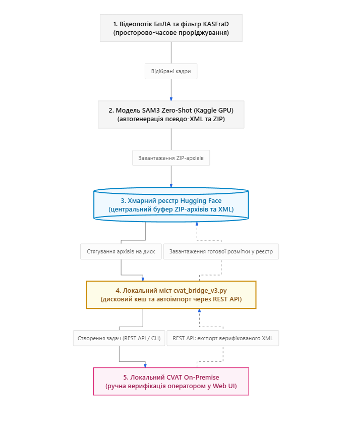

# 2. Математична модель KASFraD та конвеєр підготовки даних

## 2.1 Проблема надлишковості відеоданих
Відеопотоки курсових камер БпЛА містять високу просторово-часову надлишковість (зависання над однотипними ділянками, плавні прольоти). Навчання детектора на таких послідовностях веде до:
1. Перенавчання на статичні фонові ознаки ландшафту.
2. Неефективних витрат пам'яті та ресурсів GPU.
3. Дисбалансу класів у бік порожнього фону (до 80-90%).

Для системного подолання проблеми розроблено алгоритм **KASFraD** (*Kinematically-Adaptive Spatiotemporal Frame Decimation*).

### Загальна схема конвеєра та взаємодії з CVAT

*(Повна дворівнева схема архітектури доступна у файлі [assets/long_ua.png](../assets/long_ua.png))*

---

## 2.2 Дворівнева фільтрація KASFraD

### Рівень 1: Оцінка зміни колірно-структурного фону
Поточний кадр ділиться на сітку $G \times G$ ($5 \times 5 = 25$ неперекривних блоків). Для кожного блоку будується 2D-гістограма у просторі HSV ($30 \times 32$ біни). Відстань між відповідними блоками суміжних кадрів розраховується за метрикою **Бхаттачарія**:

$$d_B(p, q) = \sqrt{1 - \sum_{i} \sqrt{p(i) \cdot q(i)}}$$

Локальний поріг спрацьовування адаптується під просторове розташування та текстурну складність:

$$T_{local}(r, c) = T_{base} \cdot M_{edge} \cdot W(r, c)$$

- $W(r, c)$: просторова вага (верхній ряд — небо/горизонт: $2.5$; центральна зона інтересу: $0.5$).
- $M_{edge}$: коєфіцієнт на основі щільності контурів Кенні (від $0.5$ для однорідного неба до $2.0$ для складної рослинності).

### Рівень 2: Кінематичний аналіз наближення (Lucas-Kanade + RANSAC)
На основі характерних точок Ши-Томазі обчислюється розріджений оптичний потік між суміжними кадрами. Робастна афінна модель фону оцінюється алгоритмом RANSAC:

$$\begin{cases} x' = a_{11}x + a_{12}y + t_x \\ y' = a_{21}x + a_{22}y + t_y \end{cases}$$

Для детекції активного зближення/пікірування обчислюється коєфіцієнт дивергенції (масштабування):

$$s = \frac{1}{2}\left(\sqrt{a_{11}^2 + a_{12}^2} + \sqrt{a_{21}^2 + a_{22}^2}\right)$$

Коли $s \ge 1.03$, вмикається режим термінального зближення — децимація вимикається для збереження 100% кадрів атаки.

---

## 2.3 Евристична дедуплікація (dHash + Laplacian) та FPS
1. **64-бітний dHash:** вхідне зображення стискається до $9 \times 8$ у градаціях сірого. Сусідні пікселі порівнюються по рядках, формуючи 64-бітне бінарне число. При відстані Хеммінга $\le 3$ фіксується дублікат.
2. **Фільтрація розмиття:** при колізії дублікатів обчислюється дисперсія оператора Лапласа $\sigma^2 = \text{Var}(\Delta L * I)$. Зберігається найчіткіший кадр.
3. **Farthest Point Sampling (FPS):** для балансування фону (рівно 10% вибірки) жадібно відбираються кадри з максимальною відстанню Хеммінга від уже обраних. Склад: 85% контрастних + 15% з помірним розмиттям руху.

### Результати конвеєра:
- v22: 11 585 кадрів $\rightarrow$ v25: 5 735 кадрів (**стиснення на 50.5%**).
- Вилучено 83.0% надлишкового фону.
- Досягнуто ідеальний баланс 90.0% позитивних кадрів / 10.0% фону.
